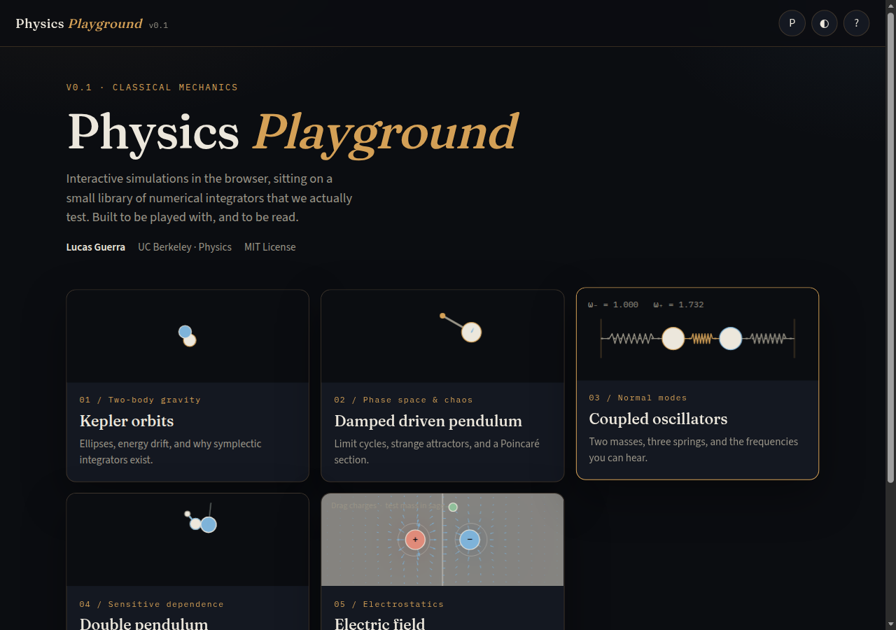
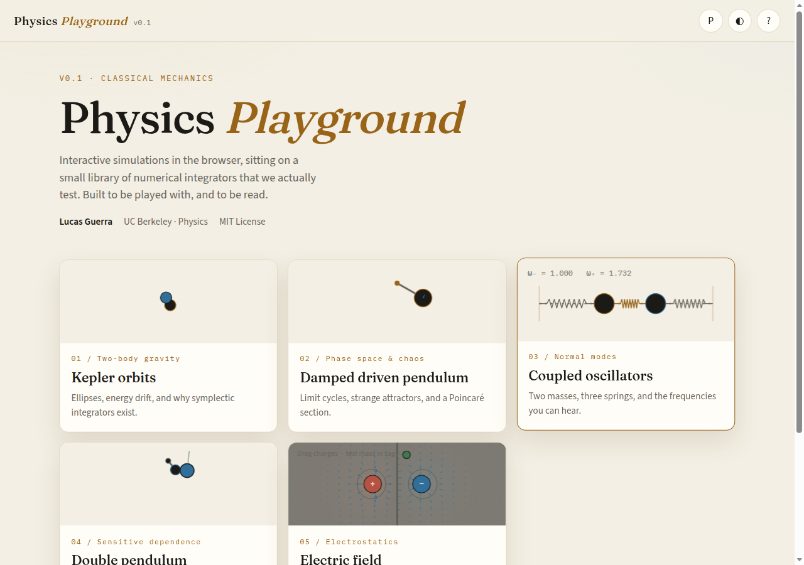
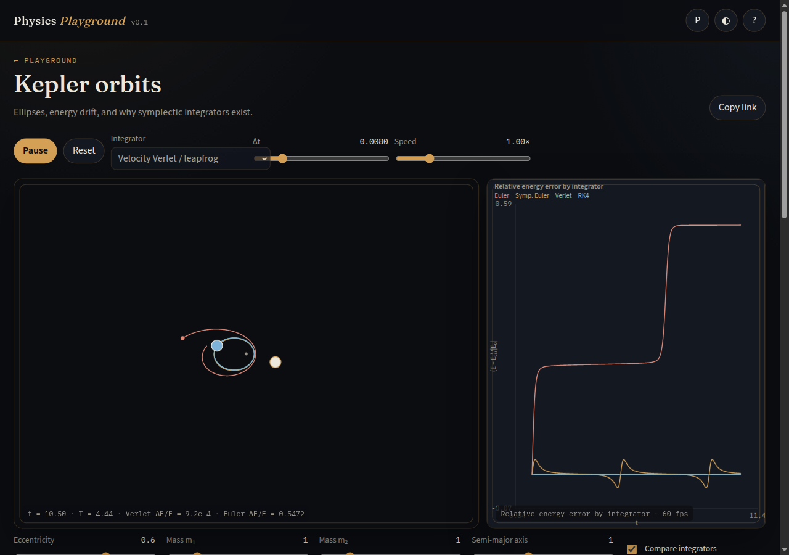
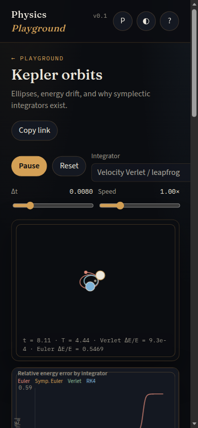
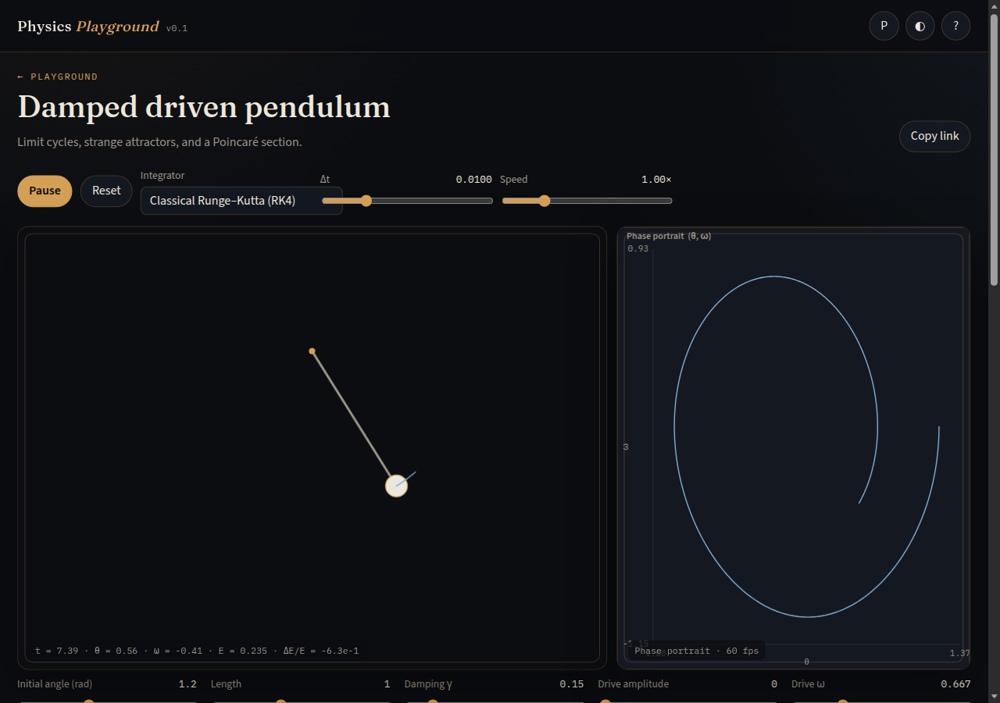
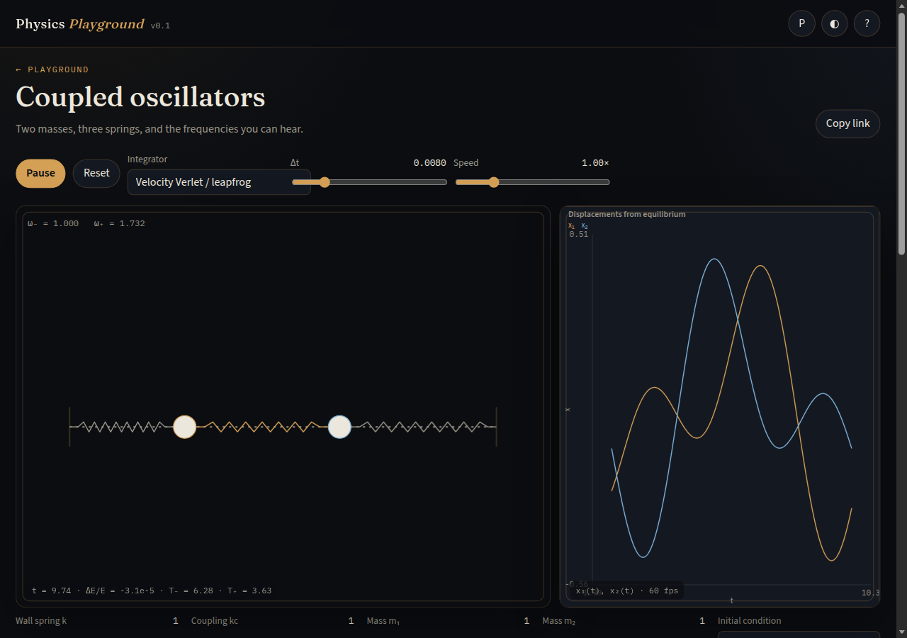
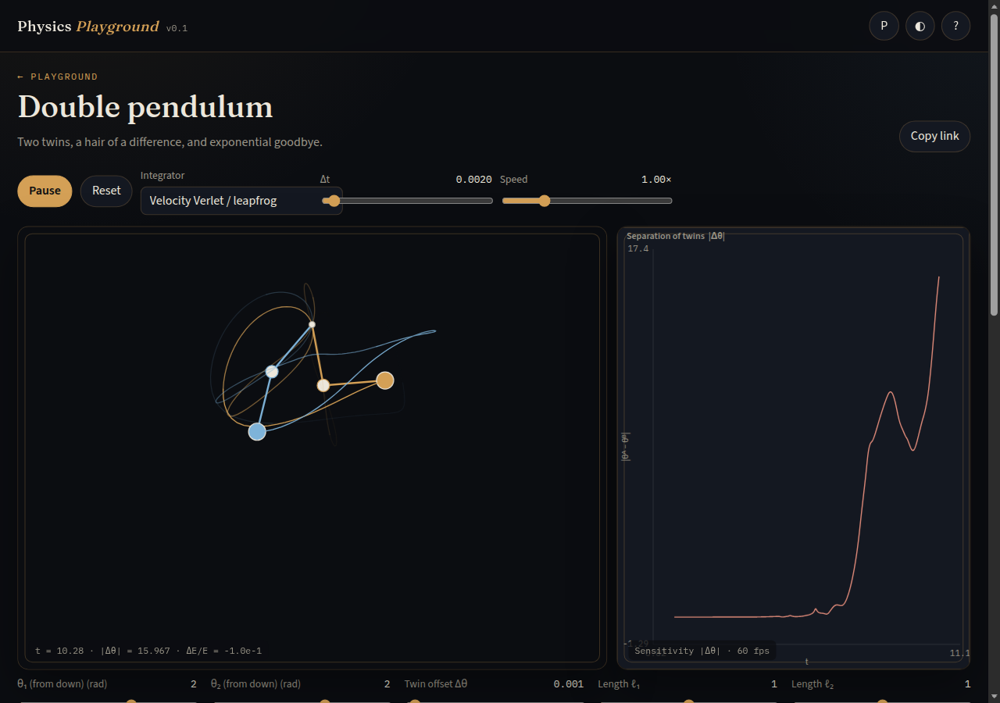
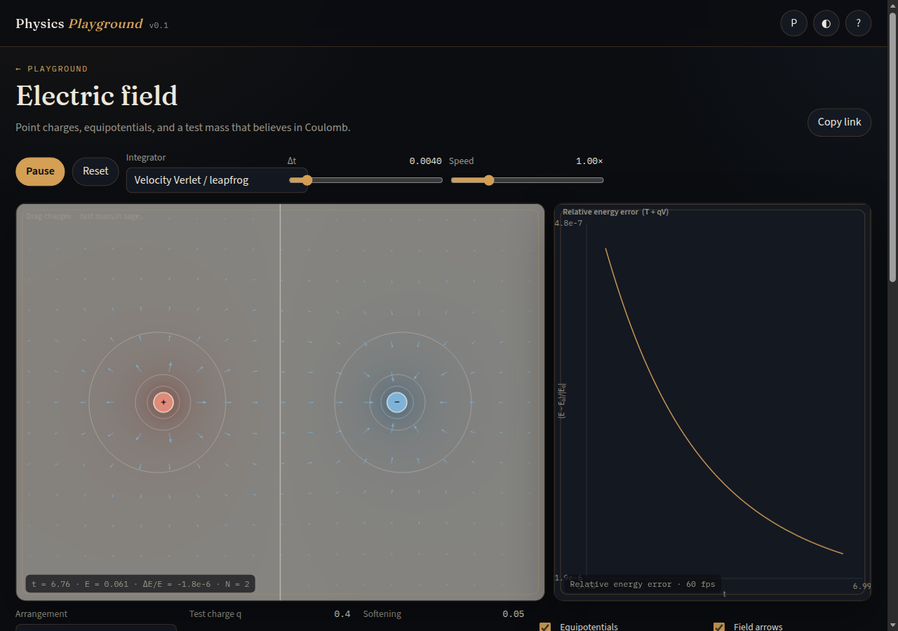

# Physics Playground

Interactive classical mechanics in the browser, sitting on a small, tested library of numerical integrators. Built by **Lucas Guerra** (GitHub [@NotSkittlz](https://github.com/NotSkittlz)), UC Berkeley physics.

The point of the project is not just pretty trajectories. Each simulation is a short argument about *what the integrator is doing to the physics* — energy drift, orbital precession, normal modes, sensitive dependence, Coulomb’s law — with equations you can read and parameters you can share.

**Live demo:** https://notskittlz.github.io/physics-playground/

> After the first deploy from `main`, GitHub Pages will serve that URL. Until then the link 404s; run `npm run dev` locally.



<p align="center"></p>

## Simulations

| # | Simulation | What you are looking at |
| --- | --- | --- |
| 01 | [Kepler orbits](#01-kepler-orbits) | Two-body gravity, integrator comparison, energy drift |
| 02 | [Damped driven pendulum](#02-damped-driven-pendulum) | Phase portrait, drive, Poincaré section, chaos |
| 03 | [Coupled oscillators](#03-coupled-oscillators) | Normal modes and beats |
| 04 | [Double pendulum](#04-double-pendulum) | Sensitivity to initial conditions |
| 05 | [Electric field](#05-electric-field) | Point charges, equipotentials, a test mass |

Every sim has play / pause / reset, an integrator picker (explicit Euler, symplectic Euler, velocity Verlet, RK4, adaptive RK45), a live energy or phase plot, sliders, and a KaTeX write-up. The URL is the state: copy the link and someone else gets the same parameters.

Keyboard: `Space` play/pause · `R` reset · `[` `]` speed · `1–5` sims · `T` theme · `P` perf · `?` help.

### 01 Kepler orbits



Two masses, inverse-square gravity, an elliptical relative orbit. Turn **Compare integrators** on: explicit Euler (rose) walks off the ellipse while Verlet (sage) and RK4 (sky) hold it. The plot is relative energy error, not a vibe check.

Mobile:

<p align="center"></p>

### 02 Damped driven pendulum



$\ddot\theta + \gamma\dot\theta + (g/L)\sin\theta = A\cos(\omega_d t)$. Closed loops when conservative, spirals with damping, a cloud in the Poincaré section once the drive is in the chaotic window ($\gamma=1/2$, $A=1.15$, $\omega_d=2/3$).

### 03 Coupled oscillators



Wall–mass–mass–wall. For equal masses the modes are $\omega_-=\sqrt{k/m}$ and $\omega_+=\sqrt{(k+2k_c)/m}$. Unequal masses solve $\det(K-\omega^2 M)=0$ and seed from the eigenvectors. Displace only $m_1$ and watch the beat.

### 04 Double pendulum



Two copies, identical except $\Delta\theta$ on the lower bob. $|\\Delta\theta|$ stays tiny, then it does not. Energy of pendulum A is the honesty check.

### 05 Electric field



Drag the charges. Equipotentials are marching squares on $V$; arrows sample $\mathbf{E}=-\nabla V$. The sage trail is a test particle whose energy $T+qV$ should be conserved in a static field.

## Integrators

Packed state $y=[q,v]$ as `Float64Array`. Integrators reuse scratch buffers and do not allocate after `ensure(nq)`. Trail fade is eight `globalAlpha` buckets, not a string per segment.

| id | Method | Order | Symplectic | Notes |
| --- | --- | --- | --- | --- |
| `euler` | Explicit Euler | 1 | no | Energy typically grows on oscillators |
| `symplectic-euler` | Semi-implicit Euler | 1 | yes | Bounded, oscillatory energy error |
| `verlet` | Velocity Verlet / leapfrog | 2 | yes, for $a=a(q)$ | Default for conservative mechanics |
| `rk4` | Classical Runge–Kutta | 4 | no | Accurate, slow secular energy drift |
| `rk45` | Dormand–Prince 5(4) | 5 | no | Adaptive $\Delta t$ to a local tolerance |

Tests in `src/integrators/step.test.ts` and `src/physics/analytic.test.ts` check:

- observed convergence order on the harmonic oscillator
- energy growth vs bounded error vs near-conservation
- Kepler vis-viva and period $T=2\pi\sqrt{a^3/G(m_1+m_2)}$
- small-angle pendulum $T=2\pi\sqrt{L/g}$
- coupled-oscillator normal-mode frequencies, including unequal masses
- double-pendulum energy and sensitive dependence
- Coulomb superposition
- a stiff spring and a high-eccentricity Kepler orbit

## Architecture

```
src/
  integrators/     Euler, symplectic Euler, Verlet, RK4, RK45
  physics/         Canonical ODEs used by both the UI and the tests
  core/            Fixed-timestep loop, HiDPI canvas, plots, URL, KaTeX
  sims/            One module per simulation (draw + write-up + controls)
  ui/              Hash router, home, sim page, a11y chrome
```

The render loop is `requestAnimationFrame`. Physics is **batched once per frame** at a fixed $\Delta t$, with an accumulator and a substep cap so a hitch cannot freeze the tab. Stepping pauses while the document is hidden. Canvases honour `devicePixelRatio` (capped at 2). Trails and plots are ring buffers. The live loop stays on the main thread because trail/plot sampling wants the CPU that just took the step, and these systems are microseconds.

Shareable state lives in the hash, so GitHub Pages does not need a server: `#/kepler?e=0.8&cmp=1&int=verlet`. Numbers are clamped to the same bounds as the sliders.

## How to add a simulation

1. Put the ODE in `src/physics/<name>.ts` as a `System` (`accel(t,q,v,out)` writes into a preallocated `Float64Array`). Export energy and any analytic helpers.
2. Add analytic tests in `src/physics/analytic.test.ts` (period, energy, a limit you can write on paper).
3. Create `src/sims/<name>.ts` implementing `Simulation` from `src/sims/types.ts`: `reset` / `apply` / `advance` / `drawWorld` / `drawPlot` / `readout` / a `meta` with controls, defaults, and a Markdown+KaTeX `writeup`.
4. Register it in `src/sims/registry.ts`.
5. Use `Integrable` from `src/sims/common.ts` so you get Verlet/RK4/RK45 for free. Sample plots into `RingSeries`. Honour `reducedMotion` with shorter trails.

That is the whole contract. The app shell will pick up the card, the hash route, the sliders, and the write-up.

## Develop

```bash
npm install
npm test          # vitest
npm run lint
npm run dev       # http://127.0.0.1:5173
npm run build     # tsc + vite, set GITHUB_PAGES=1 for the /physics-playground/ base
```

CI (`.github/workflows/ci.yml`) runs lint, typecheck, test, and build on every PR. Pages (`.github/workflows/pages.yml`) deploys `dist/` from `main` only.

## Known limitations (v0.1)

- Verlet with velocity-dependent forces (damped pendulum) is no longer symplectic; the pendulum defaults to RK4.
- Explicit methods on a stiff spring or a grazing Coulomb singularity need a small $\Delta t$ or RK45. Softening on the field is a numerical courtesy, not physics.
- Compare-integrators on Kepler disables the single-method dropdown on purpose.
- The Poincaré section interpolates $(\\theta,\\omega)$ onto each drive period as the sim runs; a dense attractor still takes a while. Let it run.
- Adaptive RK45 covering a fixed outer step can take many internal substeps on stiff problems — the perf readout will say so.
- Hash state for dragged charges is lossy to three decimals.

## Roadmap

- Poincaré burst (run $10^4$ drive periods, then draw)
- Rigid-body 3-D top, with quaternions
- Restricted three-body and Lagrange points
- Magnetic field / cyclotron, special-relativity option
- Export CSV of $(t,E)$ and a PNG of the canvas
- wasm-SIMD for a future particle-mesh field

## References

- Taylor, J. R. *Classical Mechanics*. University Science Books, 2005.
- Goldstein, H., Poole, C. & Safko, J. *Classical Mechanics*. 3rd ed.
- Griffiths, D. J. *Introduction to Electrodynamics*. 4th ed.
- Hairer, E., Lubich, C. & Wanner, G. *Geometric Numerical Integration*. Springer.
- Dormand, J. R. & Prince, P. J. “A family of embedded Runge–Kutta formulae.” *J. Comp. Appl. Math.* 6 (1980) 19.
- Strogatz, S. H. *Nonlinear Dynamics and Chaos*.

## License

MIT. Copyright (c) 2026 Lucas Guerra.
